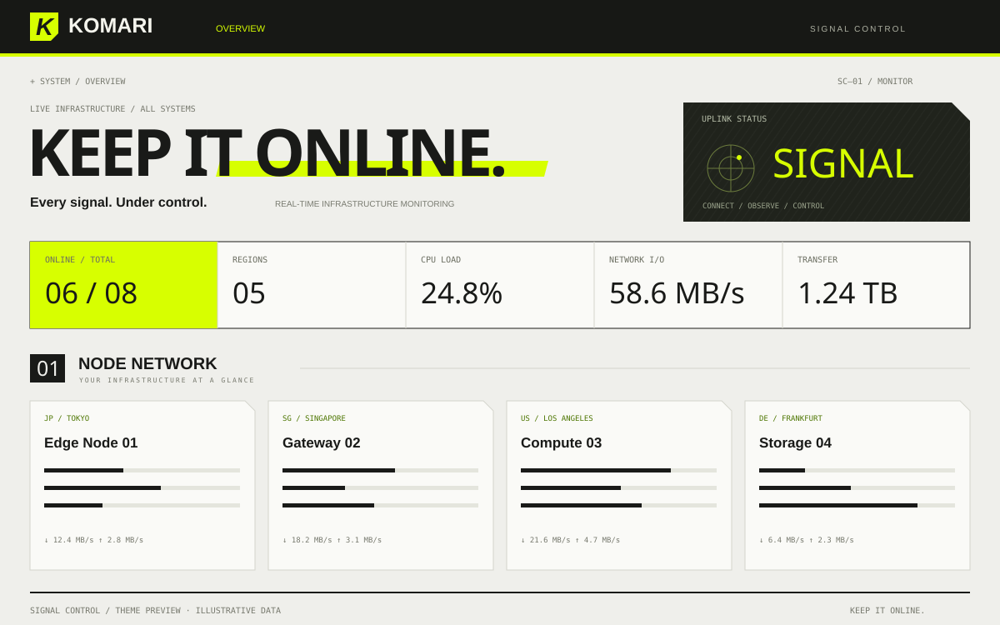

# SIGNAL CONTROL

基于 [Komari Web](https://github.com/komari-monitor/komari-web) 开发的服务器监控主题。采用黑白灰、荧光黄绿和切角面板，支持桌面及手机布局、节点卡片与表格、详情图表和自定义背景。



## 安装

1. 先安装并运行 [Komari](https://github.com/komari-monitor/komari)。
2. 在 [Releases](https://github.com/loutaiyue/komari-theme-zzz/releases) 页面下载 `signal-control-v1.0.0.zip`。请选择主题 ZIP 附件，GitHub 自动生成的 `Source code` 是源码包。
3. 在 Komari 后台进入 **主题管理 → 上传主题**，上传 ZIP 并应用 **SIGNAL CONTROL**。

主题由 Komari 提供服务，服务器无需额外运行 Node.js 或 Vite。建议将站点部署在独立域名或子域名的根路径。

## 背景图片

- **全站背景**：管理员在主题设置中分别填写桌面端、移动端图片 URL。移动端留空时使用桌面端图片。
- **个人背景**：点击导航栏的图片按钮，选择本地 JPG、PNG 或 WebP，最大 20 MB。图片在浏览器处理和保存，不上传服务器，也不会影响其他访客。
- **背景强度**：可调范围为 5–45%，默认 20%。个人设置优先；恢复默认后使用站点设置。

## 本地开发

需要 Node.js 22 或更新版本，以及一个可访问的 Komari 后端。

```sh
npm ci
```

复制 `.env.example` 为 `.env.development`，将 `VITE_API_TARGET` 设为后端地址，然后启动：

```sh
npm run dev
```

运行主题测试及生产构建：

```sh
npm run test:theme
npm run build
```

## 打包与发布

Windows PowerShell：

```powershell
.\build-theme.ps1
```

Linux/macOS（需要 `zip`）：

```sh
bash build-theme.sh
```

安装包输出到 `release/`，ZIP 根目录包含：

```text
komari-theme.json
preview.svg
dist/
```

GitHub Actions 会在推送或 Pull Request 时执行主题测试、构建并保存安装包。发布与清单版本一致的 Release（例如 `v1.0.0`）后，工作流会将安装包上传到该 Release。

更多背景设置和样式维护说明见 [SIGNAL-CONTROL.md](SIGNAL-CONTROL.md)。

## 致谢

基于 Akizon77 及 [Komari Web 贡献者](https://github.com/komari-monitor/komari-web/graphs/contributors) 的工作，保留原有 API、实时数据及后台管理功能。受《绝区零》视觉语言启发，主题不包含游戏官网角色、美术或品牌素材。
